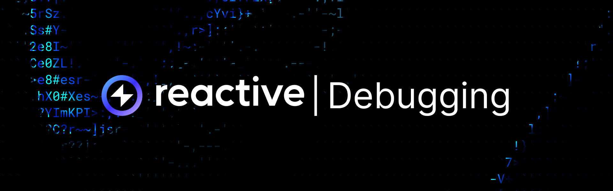
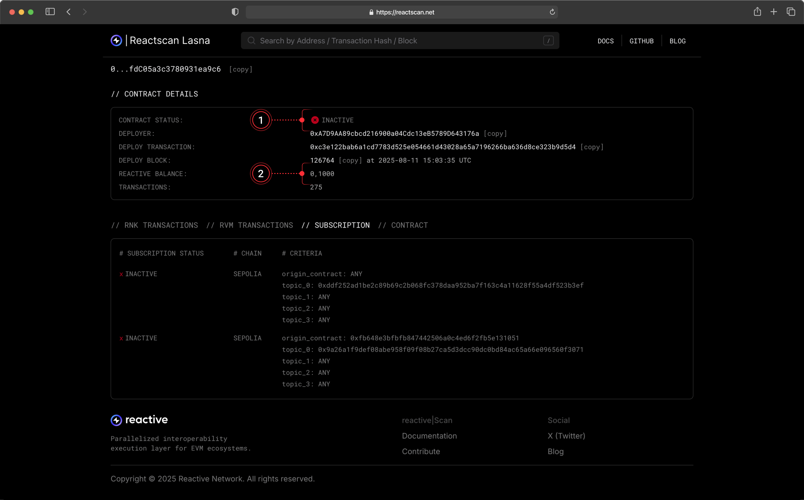

## Overview

The debugging page is dedicated to key operational and troubleshooting details for Reactive Network and beyond. Use it as a quick reference when setting up or troubleshooting your deployments.

## Callback Structure

Callbacks **must include at least one argument** — the first slot **must always be left for an RVM address**. Omitting it will cause the call to fail. Reactive automatically overwrites the first 160 bits of the payload with the relevant **RVM ID** (the deployer’s address).

Callback payload example:

```solidity
bytes memory payload = abi.encodeWithSignature(
    "stop(address,address,address,bool,uint256,uint256)",
    address(0),
    pair,
    client,
    token0,
    coefficient,
    threshold
);
emit Callback(chain_id, stop_order, CALLBACK_GAS_LIMIT, payload);
```

[More on Callbacks →](reactive-contracts.mdx#requesting-callbacks)

## Contract Inactive

If you see `Contract Status: Inactive` on Reactscan, it means the contract doesn’t have enough funds to cover gas for Reactive transactions. Both destination and Reactive contracts must hold sufficient balance to stay active.



You can either fund the relevant contract on deployment:

```bash
forge create --broadcast --rpc-url $RPC_URL --private-key $PRIVATE_KEY $CONTRACT_PATH --value $VALUE --constructor-args $ARG1 $ARG2 ...
```

Or transfer funds manually after deployment, calling `coverDebt()` afterward:

```bash
cast send $CONTRACT_ADDR --rpc-url $RPC_URL --private-key $PRIVATE_KEY --value $VALUE
```

```bash
cast send --rpc-url $RPC_URL --private-key $PRIVATE_KEY $CONTRACT_ADDR "coverDebt()"
```

You can verify a contract’s balance anytime on Reactscan or via Foundry cast command:

```bash
cast balance $CONTRACT_ADDR --rpc-url $RPC_URL
```

To check the outstanding debt, query the relevant proxy contract (`0x8888888888888888888888888888888888888888` on Reactive):

```bash
cast call $PROXY_ADDR "debts(address)" $CONTRACT_ADDR --rpc-url $RPC_URL | cast to-dec
```

[More on Reactive Economy →](economy.mdx)

## Callbacks Silently Not Delivered

A contract can request a callback that is never dispatched, with no error on any chain. The signature: `react()` clearly ran — its events are visible on Reactive and the reactive transaction shows the callback being placed — yet nothing ever arrives on the destination chain.

The usual cause is debt that accrued while the triggering logs were still being processed. Every matched log is delivered and billed as its own reactive transaction, so a burst of matching logs charges the contract back to back. Once the burst exhausts reserves and balance, the network stops serving the contract — including delivery of the callback that the same burst requested. The contract goes quiet rather than failing loudly, and the missing callback is the only symptom. Reactscan shows the contract as inactive (see [Contract Inactive](#contract-inactive)), but nothing reverts anywhere.

Confirm the diagnosis by querying the debt; anything greater than zero blocks execution:

```bash
cast call $SYSTEM_CONTRACT_ADDR "debt(address)" $REACTIVE_CONTRACT_ADDR --rpc-url $REACTIVE_RPC | cast to-dec
```

Then check whether a delivery was ever recorded for the reactive transaction that placed the callback. Records are written only after delivery, so an empty array means no delivery has happened — allow some time before concluding the callback was dropped:

```bash
cast call $SYSTEM_CONTRACT_ADDR "getCallbacks(uint256)((uint256,address,uint256,uint256,uint256,bytes)[])" $REACTIVE_TX_HASH --rpc-url $REACTIVE_RPC
```

To recover, settle the debt with `depositTo()` and re-trigger the source event if the missed callback still matters. To prevent a recurrence, size the float for the worst-case number of matching logs a single origin transaction can produce — see [Sizing the Float](economy.mdx#sizing-the-float).

A worked example from a live deployment: a monitoring contract on Reactive Lasna (November 2026) funded with 0.3 REACT was hit by a deliberately triggered 60-log event storm, which exhausted the float mid-flight, put the contract in debt, and left its requested pause callback undelivered — while the same flow, redeployed with a storm-sized float, delivered in seconds. The full postmortem with transaction hashes is in the [reactive-vault-guard](https://github.com/AlexLavoie42/reactive-vault-guard) repository.

[More on Reactive Economy →](economy.mdx)

## Getting Testnet lREACT

### Reactive Faucet

To obtain testnet **lREACT**, send **ETH** to one of the Reactive faucet contracts:

```json
Ethereum Sepolia: 0x9b9BB25f1A81078C544C829c5EB7822d747Cf434

Base Sepolia: 0x2afaFD298b23b62760711756088F75B7409f5967
```

The exchange rate is **1:100** — for each **ETH** sent, you receive **100 lREACT**. You can make the transfer using **MetaMask** or any Ethereum-compatible wallet.

:::info[Important]
**Do not** send more than **5 ETH** in a single transaction. Any excess will be **lost**. Maximum per request: **5 ETH → 500 lREACT**.
:::

### ReacDEFI Swap

You can also swap ETH for lREACT directly using [ReacDEFI](https://reacdefi.app/markets#testnet-faucet). Select the desired lREACT amount, and the app will calculate the required ETH. An Ethereum/Base Sepolia wallet (MetaMask or Coinbase) must be connected.

### Terminal Request

You can also request lREACT by calling `request()` on one of the faucet contracts:

```bash
cast send 0x9b9BB25f1A81078C544C829c5EB7822d747Cf434 \
  --rpc-url $ETHEREUM_SEPOLIA_RPC \
  --private-key $ETHEREUM_SEPOLIA_PRIVATE_KEY \
  "request(address)" $CONTRACT_ADDR \
  --value 0.1ether
```

```bash
cast send 0x2afaFD298b23b62760711756088F75B7409f5967 \
  --rpc-url $BASE_SEPOLIA_RPC \
  --private-key $BASE_SEPOLIA_PRIVATE_KEY \
  "request(address)" $CONTRACT_ADDR \
  --value 0.1ether
```

[More on Reactive Faucet →](reactive-mainnet.mdx#get-testnet-react)

## Reactive Faucet Issue

If you’ve sent **ETH** to the Reactive Faucet at `0x9b9BB25f1A81078C544C829c5EB7822d747Cf434` (Ethereum Sepolia) or `0x2afaFD298b23b62760711756088F75B7409f5967` (Base Sepolia) but haven’t received **lREACT** within a few minutes, the faucet might be experiencing a temporary issue. Report it in our [General Telegram channel](https://t.me/reactivedevs/1). You will receive your test lREACT once the issue is resolved.

## Nonce & Gas Price Issue

When encountering the `Replacement transaction underpriced` error, it means a new transaction is trying to replace a pending one with an equal or lower gas price. To fix this, first check your current **nonce**:

```bash
cast nonce --rpc-url $REACTIVE_RPC $CONTRACT_ADDR
```

Then resend the transaction with the same nonce, but specify higher gas prices using the `--priority-gas-price` and `--gas-price` flags:

```bash
cast send --rpc-url $REACTIVE_RPC --private-key $PRIVATE_KEY --priority-gas-price $VALUE --gas-price $VALUE --nonce $VALUE $CONTRACT_ADDR …
```

## MetaMask Smart Transactions Issue

When trying to perform a transaction on Reactive Network, a bridge transfer or faucet claim, MetaMask may show a message like `Smart Transaction interrupted — this transaction was going to fail` or the transaction may never appear on-chain.

MetaMask has a feature called **Smart Transactions**, which routes transactions through a special **“smart address”** instead of your regular wallet address.
These smart contracts are not deployed on the **Reactive Network**, so any operations relying on direct wallet transactions (like our bridge or faucet) will fail.

You will need to disable Smart Transactions in MetaMask:

1. Open MetaMask.
2. Tap the **menu icon** (☰) in the top-right corner.
3. Go to **Settings → Advanced.**
4. Find **Smart Transactions.**
5. Toggle it **OFF.**

After this, your transactions will go through the regular route and should work correctly.

[More on MetaMask's Smart Transactions →](https://support.metamask.io/manage-crypto/transactions/smart-transactions/)