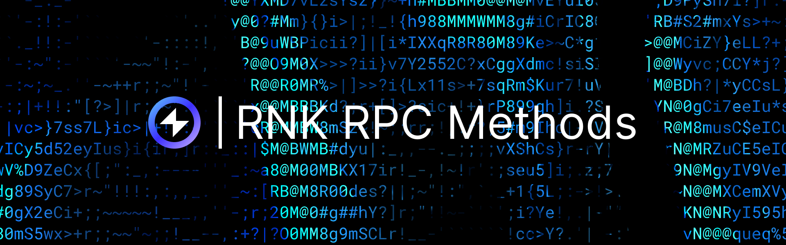

## Overview

This page documents **Reactive-specific JSON-RPC methods** available in Reactive Network's Geth version. Use them to query active event filters, individual filter details, and block-level reactive transaction sequences.

## rnk_getFilters

Returns all active event filters currently registered on Reactive Network, along with the current filter version.

#### Parameters

This method does not require any input parameters.

#### cURL

```bash
curl --location 'https://lasna-rpc.rnk.dev/' \
--header 'Content-Type: application/json' \
--data '{
  "jsonrpc": "2.0",
  "method": "rnk_getFilters",
  "params": [],
  "id": 1
}' | jq
```

#### Response

Returns an object with the following fields:

- **version** (`uint32`): The current version of the filter set. Incremented whenever filters are added or removed.
- **topicFilters** (`array[object]`): A list of active topic filters. Each filter object contains:
  - **Uid** (`string`): The unique identifier of the filter, generated by the contract.
  - **ChainId** (`uint64`): The origin chain ID. `0` matches any chain.
  - **Contract** (`string | null`): The address of the origin contract being monitored. Null address matches any contract.
  - **Topics** (`array[string | null]`): An array of up to 4 log topics (`topic_0` through `topic_3`) used for event filtering. Null entries match any topic.
  - **Configs** (`array[object]`): An array of subscription configurations. Each config contains:
    - **Contract** (`string`): The Reactive contract address subscribed to this filter.
    - **RvmId** (`string`): The address of the associated RVM instance.
    - **Active** (`bool`): Whether the subscription is currently active.

```json
{
  "jsonrpc": "2.0",
  "id": 1,
  "result": {
    "version": 42,
    "topicFilters": [
      {
        "Uid": "0x6a13fb25641a7b730b319ae22f42876a",
        "ChainId": 5318007,
        "Contract": "0x70585aba609bf77a67b91b68298f34237fde1b90",
        "Topics": [
          "0xca6e822df923f741dfe968d15d80a18abd25bd1e748bcb9ad81fea5bbb7386af",
          null,
          null,
          null
        ],
        "Configs": [
          {
            "Contract": "0x70585aba609bf77a67b91b68298f34237fde1b90",
            "RvmId": "0x0000000000000000000000000000000000000000",
            "Active": true
          }
        ]
      }
    ]
  }
}
```

## rnk_getFilterById

Returns details of a specific event filter by its unique identifier.

#### Parameters

1. **filterId**: `string` — The unique identifier of the filter to retrieve.

#### cURL

```bash
curl --location 'https://lasna-rpc.rnk.dev/' \
--header 'Content-Type: application/json' \
--data '{
  "jsonrpc": "2.0",
  "method": "rnk_getFilterById",
  "params": [
    "0xadb7fbfd0a567716dc6d1a52ec8cfd86"
  ],
  "id": 1
}' | jq
```

#### Response

Returns a filter object with the following fields:

- **Uid** (`string`): The unique identifier of the filter, generated by the contract.
- **ChainId** (`uint64`): The origin chain ID. `0` matches any chain.
- **Contract** (`string | null`): The address of the origin contract being monitored. Null address matches any contract.
- **Topics** (`array[string | null]`): An array of up to 4 log topics (`topic_0` through `topic_3`) used for event filtering. Null entries match any topic.
- **Configs** (`array[object]`): An array of subscription configurations. Each config contains:
  - **Contract** (`string`): The Reactive contract address subscribed to this filter.
  - **RvmId** (`string`): The address of the associated RVM instance.
  - **Active** (`bool`): Whether the subscription is currently active.

```json
{
  "jsonrpc": "2.0",
  "id": 1,
  "result": {
    "Uid": "0xbce1695aafe72c3929c5dacf2a4c1f8d",
    "ChainId": 11155111,
    "Contract": "0x3feb01b66bd77e8105e2c97e7f4eebb44ad8b83f",
    "Topics": [
      "0x552b2dd798eedf0c450199b5a7c35ff9f2955c113876b1afbe87060335b31653",
      null,
      null,
      null
    ],
    "Configs": [
      {
        "Contract": "0xff18d4a21c9f5780f753432aa45f0c43b9c1b462",
        "RvmId": "0x941b727ad8acf020558ce58cd7cb65b48b958db1",
        "Active": false
      }
    ]
  }
}
```

## rnk_getCallBackLogs

Returns the callbacks emitted in a given Reactive Network block. Each entry pairs the reactive transaction with the callback logs it produced.

#### Parameters

1. **blockNumber**: `uint64` — The block number as a decimal integer (not hex, not quoted).

#### cURL

```bash
curl --location 'https://lasna-rpc.rnk.dev/' \
--header 'Content-Type: application/json' \
--data '{
  "jsonrpc": "2.0",
  "method": "rnk_getCallBackLogs",
  "params": [
    7973280
  ],
  "id": 1
}' | jq
```

#### Response

Returns an array of objects, one per reactive transaction that emitted callbacks. Each object contains:

- **migrationProxy** (`object`): The mapping between the legacy RVM address and the contract's address on Reactive Network:
  - **RvmId** (`string`): The legacy RVM address.
  - **RnkContract** (`string`): The contract's address on Reactive Network.
- **trx** (`object`): The reactive transaction, in the standard Ethereum transaction format.
- **logs** (`array[object]`): The callback logs emitted by the transaction, in the standard Ethereum log format. For each log, `topic_1` is the destination chain ID, `topic_2` is the destination contract address, and `topic_3` is the callback gas limit.

```json
{
  "jsonrpc": "2.0",
  "id": 1,
  "result": [
    {
      "migrationProxy": {
        "RvmId": "0x1234e8c7f3176c2f18dde6df178f13de006e20e8",
        "RnkContract": "0x740c2b88cdbb84b67914b37562b8733174b76d04"
      },
      "trx": {
        "type": "0x2",
        "chainId": "0x512577",
        "nonce": "0x29a481",
        "to": "0x0000000000000000000000000000000000ffffff",
        "gas": "0xdbba0",
        "gasPrice": null,
        "maxPriorityFeePerGas": "0x174876e800",
        "maxFeePerGas": "0x174876e800",
        "value": "0x0",
        "input": "0xcebbda8d...",
        "accessList": [],
        "v": "0x1",
        "r": "0x3324b111e6cd273256d2fad3b67f35be04b15a45b1890cc83bc434a9d09be884",
        "s": "0x59f12a5207eec7883ff09619de698220e87288ef0b0e1a8cbe5c50d4c55e688e",
        "yParity": "0x1",
        "hash": "0x6dacb1e252ccd5d556ce62e90770bcd8c6a923430a8aed4b1b710b8f17208137"
      },
      "logs": [
        {
          "address": "0x000c008800bb84b67900007562b8730074006d00",
          "topics": [
            "0x8dd725fa9d6cd150017ab9e60318d40616439424e2fade9c1c58854950917dfc",
            "0x0000000000000000000000000000000000000000000000000000000000aa36a7",
            "0x000000000000000000000000514b8e8b4d9032f7f90afe851c08a8bf92f8f545",
            "0x00000000000000000000000000000000000000000000000000000000001312d0"
          ],
          "data": "0x0000000000000000000000000000000000000000000000000000000000000020...",
          "blockNumber": "0x79a9a0",
          "transactionHash": "0x6dacb1e252ccd5d556ce62e90770bcd8c6a923430a8aed4b1b710b8f17208137",
          "transactionIndex": "0x1",
          "blockHash": "0x32f49087c4e6ce00e5c8079ec9e7554c3f7fbb24c7c582c63bb008dab46e5b01",
          "blockTimestamp": "0x0",
          "logIndex": "0x3",
          "removed": false
        }
      ]
    }
  ]
}
```

## rnk_getBlockSequences

Returns the reactive transaction sequences processed in a given Reactive Network block. Each sequence represents a batch of reactive transactions triggered by origin-chain events.

#### Parameters

1. **blockNumber**: `string` — The hex-encoded block number for which to retrieve reactive transaction sequences.

#### cURL

```bash
curl --location 'https://lasna-rpc.rnk.dev/' \
--header 'Content-Type: application/json' \
--data '{
  "jsonrpc": "2.0",
  "method": "rnk_getBlockSequences",
  "params": [
    "0x4702EC"
  ],
  "id": 1
}' | jq
```

#### Response

Returns an object with the following fields:

- **StateRoot** (`string`): The Merkle state root after processing the sequences.
- **FromSeq** (`uint64`): The starting sequence number in this block.
- **ToSeq** (`uint64`): The ending sequence number in this block.
- **FiltersVersion** (`uint32`): The filter set version used when processing this block.
- **GasUsed** (`uint32`): The total gas consumed by reactive transactions in this block.
- **ReactiveTxCount** (`uint16`): The number of reactive transactions executed in this block.
- **Sequences** (`array`): The RLP-encoded reactive transaction sequences.

```json
{
  "jsonrpc": "2.0",
  "id": 1,
  "result": {
    "StateRoot": "0x932ec31ed84d2f36001a55777024b592670674c9f7f1cea66a494ef1ca745627",
    "FromSeq": 138210576,
    "ToSeq": 138210613,
    "FiltersVersion": 0,
    "FiltersDigest": "0xaccc05596ea0602947da5a52ec749731345b4f775364ac1181c3b685d7971983",
    "GasUsed": 22715,
    "ReactiveTxCount": 0,
    "Sequences": []
  }
}
```

## rnk_getCommittedSequenceFrontier

Returns the latest committed block height and its reactive transaction sequence range. The result is a subset of the data returned by [rnk_getBlockSequences](#rnk_getblocksequences).

#### Parameters

This method does not require any input parameters.

#### cURL

```bash
curl --location 'https://lasna-rpc.rnk.dev/' \
--header 'Content-Type: application/json' \
--data '{
  "jsonrpc": "2.0",
  "method": "rnk_getCommittedSequenceFrontier",
  "params": [],
  "id": 1
}' | jq
```

#### Response

Returns an object with the following fields:

- **height** (`string`): The hex-encoded number of the latest committed block.
- **fromSeq** (`string`): The hex-encoded starting sequence number in that block.
- **toSeq** (`string`): The hex-encoded ending sequence number in that block.

```json
{
  "jsonrpc": "2.0",
  "id": 1,
  "result": {
    "height": "0x79b121",
    "fromSeq": "0xa4ac570",
    "toSeq": "0xa4ac575"
  }
}
```